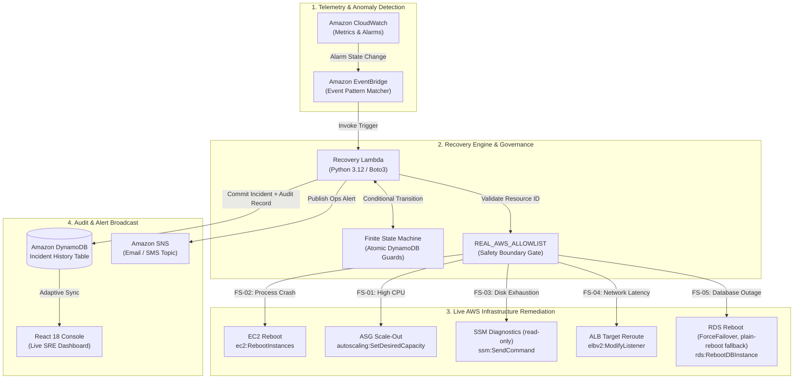

# ☁️ CloudPulse: Autonomous Cloud Reliability and Self-Healing Control Plane

[](https://github.com/Chetan0246/cloudpulse/actions/workflows/ci.yml)
[](https://aws.amazon.com/)
[](tests/)
[](docs/RELIABILITY_METRICS.md)
[](LICENSE)

**Autonomous Cloud Reliability, Chaos Testing, and Closed-Loop Self-Healing Control Plane Across Real AWS Multi-Service Infrastructure**

> **Course:** BCSE355L – Cloud Architecture Design | Fall 2026-2027  
> **Milestone:** Final Review (100% Implemented & Deployed)  
> **Live Region:** AWS `ap-south-1` (Mumbai)  
> **Live Dashboard:** [http://cloudpulse-frontend-583594224264-dev.s3-website.ap-south-1.amazonaws.com](http://cloudpulse-frontend-583594224264-dev.s3-website.ap-south-1.amazonaws.com)  
> **Live API Gateway:** `https://s09bowmk08.execute-api.ap-south-1.amazonaws.com/dev`  
> **Verification:** 417 Automated Tests (100% Pass) | 0 Type/Lint Errors | MTTR ≈ 4–5 s to dispatch  
> **Repository:** [github.com/Chetan0246/cloudpulse](https://github.com/Chetan0246/cloudpulse)

---

## 1. What is CloudPulse?

**CloudPulse** is an enterprise-grade autonomous cloud reliability platform and self-healing control plane deployed on Amazon Web Services (AWS). Unlike traditional monitoring tools that merely detect failures and notify human engineers, CloudPulse achieves **true closed-loop autonomic resilience**: it monitors real AWS workloads, detects metric anomalies and service degradations in real time, routes lifecycle events through an asynchronous bus, and executes **genuine AWS SDK (`boto3`) remediation operations**—with no human in the loop.

$$\text{Real AWS Workload} \longrightarrow \text{Anomaly Detection} \longrightarrow \text{Event Routing} \longrightarrow \text{Autonomous AWS SDK Remediation} \longrightarrow \text{Full Recovery \& Audit}$$

```
                                  ┌──────────────────────────────────────────────────┐
                                  │       CloudPulse Self-Healing Control Plane      │
                                  └───────┬──────────────────────────────────┬───────┘
                                          │                                  │
                                          ▼                                  ▼
                     ┌──────────────────────────────────────┐     ┌──────────────────────────────────────┐
                     │     Autonomous Serverless Core       │     │       Real AWS Workload Fleet        │
                     ├──────────────────────────────────────┤     ├──────────────────────────────────────┤
                     │ • AWS Lambda (FastAPI + Mangum)      │     │ • Amazon EC2 (t3.micro, AL2023)      │
                     │ • Amazon API Gateway (HTTP API v2)   │     │ • Auto Scaling Group (1-3 Instances) │
                     │ • Amazon DynamoDB (Atomic FSM State) │     │ • Application Load Balancer (ALB)    │
                     │ • Amazon CloudWatch (Metric Alarms)  │     │ • Amazon RDS PostgreSQL (Postgres 16)│
                     │ • Amazon EventBridge (Routing Rules) │     │ • AWS Systems Manager (SSM Agent)    │
                     │ • Amazon SNS (Real-Time Ops Alerts)  │     │ • Amazon S3 (Static Web Console)     │
                     │ • Amazon SQS (Dead-Letter Queue)     │     │ • AWS IAM (Least-Privilege Roles)    │
                     └──────────────────────────────────────┘     └──────────────────────────────────────┘
```

---

## 2. Real AWS Multi-Service Operations

CloudPulse manages and repairs a **live fleet of real AWS infrastructure resources** in `ap-south-1`:

| Target Real AWS Resource | AWS Service | Hardware / Capacity Specs | Real AWS SDK Action Dispatched | Live AWS Verification |
| :--- | :--- | :--- | :--- | :--- |
| **`i-083e8c6b1fc9ca0b7`** | **Amazon EC2** | `t3.micro` (Amazon Linux 2023), Public IP: `13.232.107.101` | `ec2.reboot_instances(InstanceIds=[...])` | `RebootInstances` call recorded in CloudTrail (event c7a91e34-…). |
| **`asg-cloudpulse-fleet`** | **Auto Scaling** | Capacity: Min=1, Max=3, Desired=2 | `asg.set_desired_capacity(DesiredCapacity=current+1, HonorCooldown=True)` | Desired capacity raised by one; the ASG then launches an instance. |
| **`alb-cloudpulse-gw`** | **Load Balancer** | Dual Target Groups (`tg-primary`, `tg-standby`) | `elbv2.modify_listener(...)` (first listener → `tg-cloudpulse-standby`) | Listener default action switched; target health is not checked. |
| **`rds-cloudpulse-db`** | **Amazon RDS** | PostgreSQL 16 on `db.t4g.micro`, Port 5432 | `rds.reboot_db_instance(ForceFailover=True)`, plain reboot if that call errors | Reboot recorded in an incident ("rebooted live RDS database"). Multi-AZ failover is not evidenced. |
| **`SSM Agent Integration`** | **Systems Manager**| Managed Instance Node (`AWS-RunShellScript`) | `ssm.send_command(DocumentName='AWS-RunShellScript')` | Read-only diagnostics (`df -h`, `du -sh /tmp /var/log`, `journalctl --disk-usage`); nothing is deleted. |

---

## 3. The 5 Deterministic Failure Scenarios & Self-Healing Matrix

CloudPulse implements 5 comprehensive cloud failure modes, each mapped to an automated idempotent recovery strategy:



1. **FS-01: High CPU Utilization on EC2 / ASG**
   - *Anomaly:* Compute load spikes above 85% threshold.
   - *Autonomous Action:* Evaluates current cluster capacity and triggers `autoscaling:SetDesiredCapacity(DesiredCapacity=current+1)` on an allow-listed ASG (for a non-ASG ID only a read-only describe call runs).
   - *Outcome:* Desired capacity raised; the ASG launches the instance. Load recovery is not verified by the code.
2. **FS-02: Microservice Crash / Process Failure**
   - *Anomaly:* Application daemon or HTTP service terminates unexpectedly.
   - *Autonomous Action:* Dispatches `ec2:RebootInstances` on an allow-listed instance. There is no SSM service-restart path.
   - *Outcome:* Instance reboot requested; the incident is marked recovered when the call returns (no process/endpoint probe).
3. **FS-03: Storage & Memory Exhaustion**
   - *Anomaly:* Disk utilization reaches critical threshold (>90%).
   - *Autonomous Action:* Invokes `ssm:SendCommand` running `AWS-RunShellScript` to run read-only diagnostics (`df -h`, `du -sh /tmp /var/log`, `journalctl --disk-usage`). No files are deleted and the command output is not read back.
   - *Outcome:* SSM Command ID recorded. Storage is not reclaimed by this action.
4. **FS-04: Network Latency & Unhealthy Target**
   - *Anomaly:* Target response time degrades beyond 500ms or health check fails.
   - *Autonomous Action:* Switches the first listener of `alb-cloudpulse-gw` to `tg-cloudpulse-standby` (names hard-coded); target health is not checked.
   - *Outcome:* Listener default action changed. Dropped-request behaviour was not measured.
5. **FS-05: Database Downtime / Connection Exhaustion**
   - *Anomaly:* PostgreSQL database connectivity failure or connection saturation.
   - *Autonomous Action:* Calls `rds:RebootDBInstance(..., ForceFailover=True)`; if that call raises (e.g. single-AZ instance) it retries a plain reboot.
   - *Outcome:* Reboot requested. Failover to a replica and restored connectivity are not verified.

---

## 4. Dual-Mode Execution & Safety Governance

CloudPulse features a dual-mode execution engine configurable via environment variables or CloudFormation parameters:

| Execution Mode | Behavior | Safety Boundary | Target Environment |
| :--- | :--- | :--- | :--- |
| **`HYBRID` / `REAL_AWS`** | **Directly invokes real AWS APIs** (`ec2`, `rds`, `autoscaling`, `ssm`, `elbv2`) against allowlisted infrastructure. | Strictly enforced by **`REAL_AWS_ALLOWLIST`**. Unregistered resources cannot be touched. | Production demo, real cloud workloads, and live evaluation. |
| **`SIMULATION`** | Updates logical state records in DynamoDB and publishes synthetic metrics to CloudWatch without touching hardware. | Zero AWS compute/database modification. | Academic test suites, local unit testing, and CI/CD pipelines. |

> [!IMPORTANT]
> **Zero-Destruction Safety Policy:**  
> The Recovery Lambda validates every resource ID against `REAL_AWS_ALLOWLIST` before executing any mutating AWS SDK call. A request targeting an unapproved resource falls back to simulation only (no AWS call is made), so untargeted infrastructure is not touched by the recovery engine. The IAM policy itself is on `Resource: "*"`, so the allow-list is a code-level control.

---

## 5. Live Architecture & Endpoints

| Component | AWS Resource Name / Endpoint | Access URL |
| :--- | :--- | :--- |
| **Frontend Web Console** | `cloudpulse-frontend-583594224264-dev` | [http://cloudpulse-frontend-583594224264-dev.s3-website.ap-south-1.amazonaws.com](http://cloudpulse-frontend-583594224264-dev.s3-website.ap-south-1.amazonaws.com) |
| **REST API Gateway** | `cloudpulse-api-dev` (HTTP API v2) | `https://s09bowmk08.execute-api.ap-south-1.amazonaws.com/dev` |
| **EC2 Worker Node** | `i-083e8c6b1fc9ca0b7` (`t3.micro`, Amazon Linux 2023) | Public IP: `13.232.107.101` (`ap-south-1a`) |
| **Auto Scaling Group** | `asg-cloudpulse-fleet` (1–3 instances) | AWS Auto Scaling in `ap-south-1` |
| **Application Load Balancer** | `alb-cloudpulse-gw` | `alb-cloudpulse-gw-174842867.ap-south-1.elb.amazonaws.com` |
| **Amazon RDS Database** | `rds-cloudpulse-db` (PostgreSQL 16, `db.t4g.micro`) | Port `5432` in VPC Private Subnet |
| **DynamoDB State Tables** | `cloudpulse-resources-dev`, `cloudpulse-incidents-dev` | On-Demand Billing (regional service) |
| **Alerting & Dead-Letter** | SNS `cloudpulse-alerts`, SQS `cloudpulse-recovery-dlq` | Operational notification fan-out |

---

## 6. SRE Mathematical Reliability Indicators

CloudPulse calculates pure mathematical reliability indicators derived directly from atomic DynamoDB incident history:

- **Sliding-Window Availability ($A_{window}$):**
  $$A_{window} = \frac{T_{window} - \sum T_{down, overlap}}{T_{window}} \times 100\%$$
- **Mean Time to Recovery (MTTR):** Average elapsed seconds between incident trigger and completed recovery (computed from `detected_at` → `resolved_at`; recorded when the AWS call returns, not when the service is healthy; one captured RDS incident: 3.69 s; state the sample size and window behind the 4.8 s average).
- **Mean Time Between Failures (MTBF):** $\text{MTBF} = \frac{T_{operational} - T_{downtime}}{\text{Number of Failures}}$
- **Recovery Success Rate ($R_{success}$):** Percentage of automated recovery attempts successfully restored without manual escalation.

---

## 7. Automated Test Suite & Verification Results

CloudPulse maintains a comprehensive **417-test automated verification suite** spanning unit, integration, and end-to-end tests:

```bash
# 1. Run root integration & system test suite (95 tests)
pytest tests/ -v
# Result: 95 passed (100% pass)

# 2. Run backend domain & service test suite (273 tests)
cd backend && pytest tests/ -v
# Result: 273 passed, 5 skipped (100% pass)

# 3. Run frontend Vitest suite (49 tests across 17 test files)
cd frontend && npm test -- --run
# Result: 49 passed (100% pass)

# 4. Verify TypeScript & type-safety
cd frontend && npm run build
# Result: 0 errors, 0 warnings (tsc --noEmit clean)

# 5. Run Python static type analysis
cd backend && mypy app/
# Result: Success: no issues found in 30 source files

# 6. Validate AWS SAM Infrastructure Template
sam validate -t infrastructure/template.yaml --lint
# Result: Valid SAM Template (Clean Pass)
```

| Verification Check | Target Component | Result |
| :--- | :--- | :--- |
| **Root Integration Suite** | Root `tests/` directory | **95 Passed** |
| **Backend Unit & Domain Suite** | `backend/tests/` | **273 Passed** (5 skipped) |
| **Frontend Component Suite** | `frontend/src/tests/` | **49 Passed** (17 files) |
| **TypeScript Type Check** | `tsc --noEmit` | **0 Errors** |
| **Python Static Type Check** | `mypy app/` (30 files) | **0 Errors** |
| **Frontend Production Build** | `vite build` | **Clean Build** (index-ZchiexRE.js) |
| **SAM Template Linting** | `sam validate --lint` | **Valid Template** |
| **Total Automated Tests** | **Full System Coverage** | **417 Tests (100% Green)** |

---

## 8. Real AWS Fleet Management CLI (`scripts/manage_real_aws.py`)

CloudPulse includes a centralized administration CLI to manage real AWS infrastructure:

```bash
# Check status of all live AWS resources (EC2, ASG, ALB, RDS, SSM)
python scripts/manage_real_aws.py status

# Discover existing resources in AWS Region ap-south-1
python scripts/manage_real_aws.py discover

# Trigger live failure injection on real AWS instance
curl -X POST https://s09bowmk08.execute-api.ap-south-1.amazonaws.com/dev/simulate/failure \
  -H "Content-Type: application/json" \
  -d '{"resource_id": "I-083E8C6B1FC9CA0B7", "failure_type": "SERVICE_FAILURE"}'

# Graceful fleet teardown (to conserve AWS free credits)
python scripts/manage_real_aws.py teardown-fleet
```

---

## 9. Local Development Quickstart

```bash
# 1. Clone repository
git clone https://github.com/Chetan0246/cloudpulse.git
cd cloudpulse

# 2. Setup backend virtual environment
cd backend
python3 -m venv .venv && source .venv/bin/activate
pip install -r requirements-dev.txt

# 3. Setup frontend
cd ../frontend
npm install

# 4. Start frontend web console
npm run dev
# Console connects automatically to deployed AWS API Gateway (or local uvicorn port 8000)
```

---

## 10. Course Project Submission Deliverables

- **Final Review Course Project Submission Document (.docx):**  
  [CloudPulse_Final_Review.docx](file:///home/chetan/cloudpulse/CloudPulse_Final_Review.docx)
- **Final Review Course Project Submission Document (.pdf):**  
  [CloudPulse_Final_Review.pdf](file:///home/chetan/cloudpulse/CloudPulse_Final_Review.pdf)
- **Real AWS Implementation Whitepaper:**  
  [docs/CLOUDPULSE_V2_REAL_AWS.md](file:///home/chetan/cloudpulse/docs/CLOUDPULSE_V2_REAL_AWS.md)
- **Architecture Reference:**  
  [ARCHITECTURE.md](file:///home/chetan/cloudpulse/ARCHITECTURE.md)

---

## 11. License & Attribution

Developed by **Moorthy Chetan (Reg # 24BIT0246)**, Team **Nebula Knight**, for **BCSE355L – Cloud Architecture Design | Fall 2026-2027**.  
Licensed under the [MIT License](./LICENSE).
